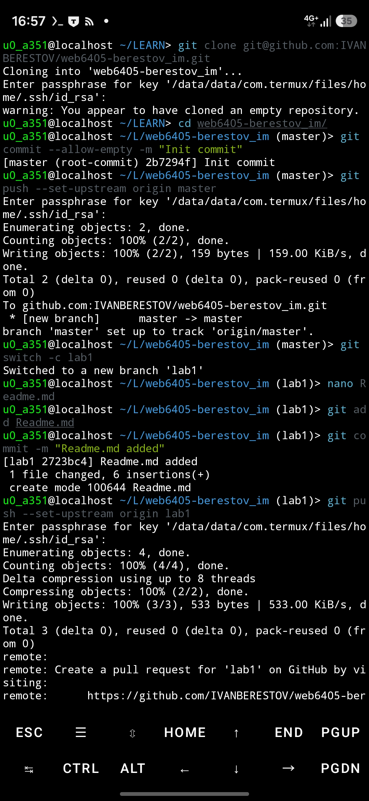
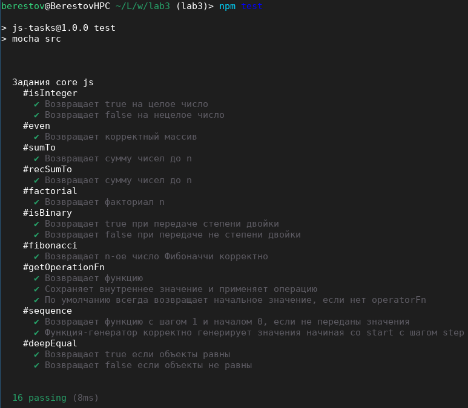

# Лабораторная работа №1

- ФИО: Берестов Иван Михайлович
- Группа: 6405-010302D
- Научный руководитель: Минаев Антон Андреевич
- Предполагаемая тема диплома: «Локализация БПЛА при помощи распределённой сети пассивных детекторов»
- Цитата: «Начало всего — единица» © Пифагор

# Лабораторная работа №2

- Тема: Прототип веб-сервиса «File Server» для загрузки файлов на сервер
- Технологии: HTML, CSS
- Количество страниц: 3
- Блочные элементы: да
- Строчные элементы: да
- Ссылки: > 1
- Изображений: 1
- Таблиц: 1
- CSS-файлов: 1
- Видов селекторов: >= 3
- Цветa: да
- Видов выравнивания в таблице: 3

# Лабораторная работа №3

## Тема: изучение основ JavaScript

### Задания core js

#### #isInteger
- ✔ Возвращает true на целое число
- ✔ Возвращает false на нецелое число

#### #even
- ✔ Возвращает корректный массив

#### #sumTo
- ✔ Возвращает сумму чисел до n

#### #recSumTo
- ✔ Возвращает сумму чисел до n

#### #factorial
- ✔ Возвращает факториал n

#### #isBinary
- ✔ Возвращает true при передаче степени двойки
- ✔ Возвращает false при передаче не степени двойки

#### #fibonacci
- ✔ Возвращает n-ое число Фибоначчи корректно

#### #getOperationFn
- ✔ Возвращает функцию
- ✔ Сохраняет внутреннее значение и применяет операцию
- ✔ По умолчанию всегда возвращает начальное значение, если нет operatorFn

#### #sequence
- ✔ Возвращает функцию с шагом 1 и началом 0, если не переданы значения
- ✔ Функция-генератор корректно генерирует значения начиная со start с шагом step

#### #deepEqual
- ✔ Возвращает true если объекты равны
- ✔ Возвращает false если объекты не равны

P.S.: В некоторых частях кода у читателя могут возникнуть вопросы\
к стилистическим решениям автора. Автор очень хотел чего-то необычного.

